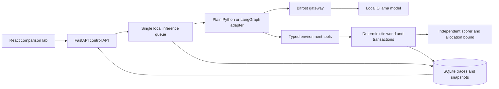

# Architecture

The model chooses among public-state actions. It never receives private evaluation profiles or the oracle solution. Passenger consent is constrained by its own synthetic contract; optional LLM passenger decisions receive only their profile, booking and own offer memory.

The team strategy uses an inventory specialist, a traveler specialist and an orchestrator through either adapter. Specialists are consulted at plan boundaries: initially, after a committed booking or after an unsuccessful action. The orchestrator sees fresh observations and reassesses historical advice between consultations. Advice carries its original tick and named action. The trace records the consultation reason alongside the plan and receipt.

A world episode owns a single mutable state. Capacity and compensation are reserved at acceptance and spent/changed atomically at commit. Old bookings remain until replacement. The model cannot execute arbitrary code or mutate storage directly. Logical interleaving does not imply concurrent model inference.

The browser renders stored state and recorded events; it does not generate an outcome or score. Initial-state forks instantiate the same scenario again. Mid-run forks are not implemented. Framework and strategy are independent configuration choices. Gateway metrics describe model calls, while environment events describe actual tool execution.

SQLite writes and reads are serialized. API handlers keep short storage operations in the same event loop; model HTTP requests are asynchronous. All services bind to loopback. Each scored live model call goes through Bifrost. Native Ollama endpoints are used only for environment inspection/model download, not bypass inference during runs.
